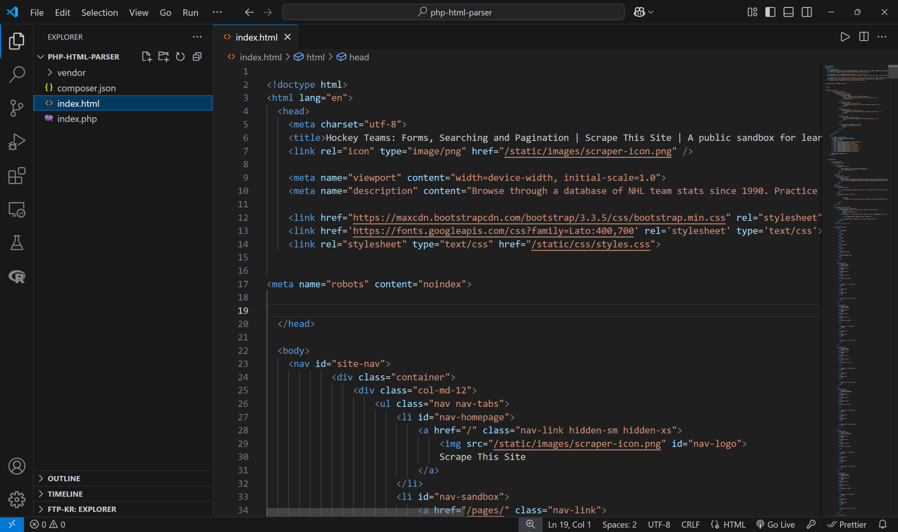
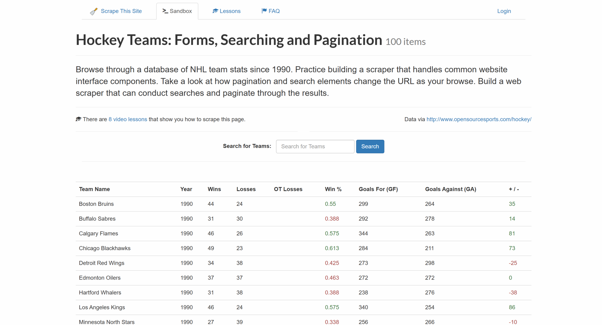
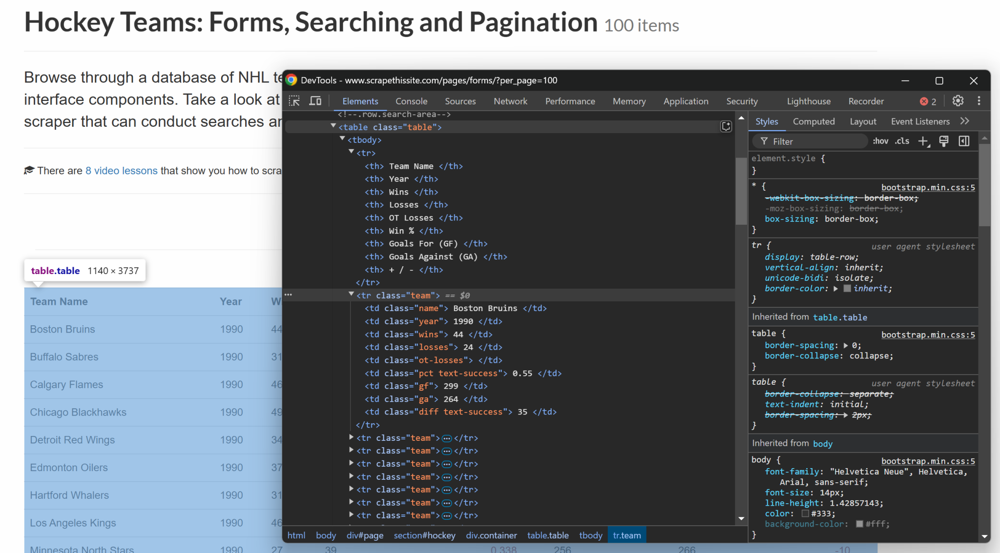

# 使用 PHP 解析 HTML

[](https://www.bright.cn/) 

本指南介绍三种使用 PHP 解析 HTML 的技术，并比较它们的优势和差异：

- [使用 PHP 解析 HTML](#使用-php-解析-html)
- [为什么要在 PHP 中解析 HTML？](#为什么要在-php-中解析-html)
- [前提条件](#前提条件)
- [在 PHP 中获取 HTML](#在-php-中获取-html)
- [在 PHP 中解析 HTML：3 种方法](#在-php-中解析-html3-种方法)
  - [方法 1：使用 `Dom\HTMLDocument`](#方法-1使用-domhtmldocument)
  - [方法 2：使用 Simple HTML DOM Parser](#方法-2使用-simple-html-dom-parser)
  - [方法 3：使用 Symfony 的 DomCrawler 组件](#方法-3使用-symfony-的-domcrawler-组件)
- [在 PHP 中解析 HTML：对比表](#在-php-中解析-html对比表)
- [总结](#总结)

## 为什么要在 PHP 中解析 HTML？

在 PHP 中解析 HTML，需要将 HTML 内容转换为其 DOM（[文档对象模型](https://developer.mozilla.org/en-US/docs/Web/API/Document_Object_Model)）结构。转换为 DOM 格式后，你可以轻松浏览和操作 HTML 内容。

具体来说，在 PHP 中解析 HTML 的主要原因包括：

- **数据提取**：从网页中获取特定内容，包括 HTML 元素中的文本或属性。  
- **自动化**：简化内容抓取、报告生成和 HTML 数据聚合等任务。  
- **服务端 HTML 处理**：解析和操作 HTML，以便在应用程序渲染网页内容之前对其进行清理、格式化或修改。  


## 前提条件

开始编写代码之前，请确保你的计算机上已安装 [PHP 8.4+](https://www.php.net/releases/8.4/en.php)。你可以运行以下命令进行验证：

```bash
php -v
```

输出应类似如下内容：

```
PHP 8.4.3 (cli) (built: Jan 19 2025 14:20:58) (NTS)
Copyright (c) The PHP Group
Zend Engine v4.4.3, Copyright (c) Zend Technologies
    with Zend OPcache v8.4.3, Copyright (c), by Zend Technologies
```

接下来，初始化一个 Composer 项目，以便更轻松地管理依赖项。如果你的系统尚未安装 Composer，请[下载 Composer](https://getcomposer.org/download/) 并按照安装说明操作。

首先，为你的 PHP HTML 项目新建一个文件夹：

```bash
mkdir php-html-parser
```

在终端中进入该文件夹，然后使用 `composer init` 命令在其中初始化 Composer 项目：

```bash
composer init
```

在此过程中，系统会询问你几个问题。使用默认答案即可，但如果需要，你也可以提供更具体的信息，以便为 PHP HTML 解析项目定制设置。

接下来，在你常用的 IDE 中打开项目文件夹。[安装了 PHP 扩展的 Visual Studio Code](https://code.visualstudio.com/docs/languages/php) 或 [IntelliJ WebStorm](https://www.jetbrains.com/webstorm/) 都是 PHP 开发的理想选择。

现在，在项目文件夹中添加一个空的 `index.php` 文件。此时，你的项目结构应如下所示：

```
php-html-parser/
  ├── vendor/
  ├── composer.json
  └── index.php
```

打开 `index.php`，并添加以下代码来初始化项目：

```php
<?php

require_once __DIR__ . "/vendor/autoload.php";

// scraping logic...
```

使用以下命令运行脚本：

```bash
php index.php
```

## 在 PHP 中获取 HTML

在 PHP 中解析 HTML 之前，你需要先获取一些待解析的 HTML。本节将介绍两种在 PHP 中访问 HTML 内容的不同方法。我们也建议你阅读[使用 PHP 进行网页爬虫的指南](https://www.bright.cn/blog/how-tos/web-scraping-php)。

### 使用 cURL

PHP 原生支持 cURL，这是一种常用于执行 HTTP 请求的热门 HTTP 客户端。[启用 cURL 扩展](https://www.php.net/manual/en/book.curl.php)，或使用以下命令在 Ubuntu Linux 上安装该扩展：

```bash
sudo apt-get install php8.4-curl
```

你可以使用 cURL 向在线服务器发送 HTTP GET 请求，并获取服务器返回的 HTML 文档。以下示例脚本会发送一个简单的 GET 请求并获取 HTML 内容：

```bash
// initialize cURL session
$ch = curl_init();

// set the URL you want to make a GET request to
curl_setopt($ch, CURLOPT_URL, "https://www.scrapethissite.com/pages/forms/?per_page=100");

// return the response instead of outputting it
curl_setopt($ch, CURLOPT_RETURNTRANSFER, true);

// execute the cURL request and store the result in $response
$html = curl_exec($ch);

// close the cURL session
curl_close($ch);

// output the HTML response
echo $html;
```

将上述代码片段添加到 `index.php` 并运行。它将生成以下 HTML 代码：

```html
<!doctype html>
<html lang="en">
  <head>
    <meta charset="utf-8">
    <title>Hockey Teams: Forms, Searching and Pagination | Scrape This Site | A public sandbox for learning web scraping</title>
    <link rel="icon" type="image/png" href="/static/images/scraper-icon.png" />
    <!-- Omitted for brevity... -->
</html>
```

### 从文件获取

假设你有一个名为 `index.html` 的文件，其中包含 [Scrape This Site](https://www.scrapethissite.com/pages/forms/?per_page=100) 上“Hockey Teams”页面的 HTML，该文件此前已使用 cURL 获取：



## 在 PHP 中解析 HTML：3 种方法

本节介绍如何使用三个不同的库在 PHP 中解析 HTML：

1. 在原生 PHP 中使用 `Dom\HTMLDocument`
2. 使用 Simple HTML DOM Parser 库
3. 使用 Symfony 的 `DomCrawler` 组件

在这三种情况下，你都需要解析本地 `index.html` 文件中的 HTML，选择页面上的所有冰球队条目并从中提取数据：



最终结果将是抓取到的冰球队条目列表，其中包含以下详细信息：

- 球队名称
- 年份
- 胜场数
- 负场数
- 胜率
- 进球数（GF）
- 失球数（GA）
- 净胜球

你可以从具有以下结构的 HTML 表格中提取这些数据：



表格行中的每一列都有特定的类，因此你可以将类用作 CSS 选择器来选择元素，并通过元素文本获取其内容，从而提取数据。

## 方法 1：使用 Dom\\HTMLDocument

PHP 8.4+ 内置了 [`Dom\HTMLDocument`](https://www.php.net/manual/en/class.dom-htmldocument.php) 类。该类表示一个 HTML 文档，支持解析 HTML 内容和浏览 DOM 树。

### 步骤 1：安装与设置

`Dom\HTMLDocument` 是 [PHP 标准库](https://www.php.net/manual/en/book.spl.php)的一部分。但要使用它，你仍需启用 [DOM 扩展](https://www.php.net/manual/en/intro.dom.php)，或通过以下 Linux 命令安装该扩展：

```bash
sudo apt-get install php-dom
```

### 步骤 2：HTML 解析

你可以按如下方式解析 HTML 字符串：

```php
$dom = \DOM\HTMLDocument::createFromString($html);
```

你可以使用以下代码解析 `index.html` 文件：

```php
$dom = \DOM\HTMLDocument::createFromFile("./index.html");
```

`$dom` 是一个 [`Dom\HTMLDocument`](https://www.php.net/manual/en/class.dom-htmldocument.php) 对象，提供数据解析所需的方法。

### 步骤 3：数据解析

你可以使用 `\DOM\HTMLDocument` 并通过以下方法选择所有冰球队条目：

```php
// select each row on the page
$table = $dom->getElementsByTagName("table")->item(0);
$rows = $table->getElementsByTagName("tr");

// iterate through each row and extract data
foreach ($rows as $row) {
  $cells = $row->getElementsByTagName("td");

  // extracting the data from each column
  $team = trim($cells->item(0)->textContent);
  $year = trim($cells->item(1)->textContent);
  $wins = trim($cells->item(2)->textContent);
  $losses = trim($cells->item(3)->textContent);
  $win_pct = trim($cells->item(5)->textContent);
  $goals_for = trim($cells->item(6)->textContent);
  $goals_against = trim($cells->item(7)->textContent);
  $goal_diff = trim($cells->item(8)->textContent);

  // create an array for the scraped team data
  $team_data = [
    "team" => $team,
    "year" => $year,
    "wins" => $wins,
    "losses" => $losses,
    "win_pct" => $win_pct,
    "goals_for" => $goals_for,
    "goals_against" => $goals_against,
    "goal_diff" => $goal_diff
  ];

  // print the scraped team data
  print_r($team_data);
  print ("\n");
}
```

`\DOM\HTMLDocument` 不提供高级查询方法，因此你必须依赖 `getElementsByTagName()` 等方法并进行手动迭代。

以下是所用方法的详细说明：

- `getElementsByTagName()`：获取文档中指定标签（如 `<table>`、`<tr>` 或 `<td>`）的所有元素。
- `item()`：从 `getElementsByTagName()` 返回的元素列表中获取单个元素。
- `textContent`：此属性用于获取元素的原始文本内容，使你可以提取可见数据（如球队名称、年份等）。

我们还使用了 [`trim()`](https://www.php.net/manual/en/function.trim.php) 来删除文本内容前后的多余空白，以获得更整洁的数据。

将上述代码片段添加到 `index.php` 后，将生成以下结果：

```php
Array
(
    [team] => Boston Bruins
    [year] => 1990
    [wins] => 44
    [losses] => 24
    [win_pct] => 0.55
    [goals_for] => 299
    [goals_against] => 264
    [goal_diff] => 35
)

// omitted for brevity...

Array
(
    [team] => Detroit Red Wings
    [year] => 1994
    [wins] => 33
    [losses] => 11
    [win_pct] => 0.688
    [goals_for] => 180
    [goals_against] => 117
    [goal_diff] => 63
) 
```

## 方法 2：使用 Simple HTML DOM Parser

[Simple HTML DOM Parser](https://github.com/voku/simple_html_dom) 是一个轻量级 PHP 库，可用于轻松解析和操作 HTML 内容。

### 步骤 1：安装与设置

你可以通过 Composer 使用以下命令安装 Simple HTML DOM Parser：

```php
composer require voku/simple_html_dom
```

或者，你也可以手动下载 `simple_html_dom.php` 文件并将其包含在项目中。

然后，在 `index.php` 中使用以下代码将其导入：

```php
use voku\helper\HtmlDomParser;
```

### 步骤 2：HTML 解析

要解析 HTML 字符串，请使用 `file_get_html()` 方法：

```php
$dom = HtmlDomParser::str_get_html($html);
```

要解析 `index.html`，请改为编写 `file_get_html()`：

```php
$dom = HtmlDomParser::file_get_html($str);
```

这会将 HTML 内容加载到 `$dom` 对象中，让你能够轻松浏览 DOM。

### 步骤 3：数据解析

使用 Simple HTML DOM Parser 从 HTML 中提取冰球队数据：

```php
// find all rows in the table
$rows = $dom->findMulti("table tr.team");

// loop through each row to extract the data
foreach ($rows as $row) {
  // extract data using CSS selectors
  $team_element = $row->findOne(".name");
  $team = trim($team_element->plaintext);

  $year_element = $row->findOne(".year");
  $year = trim($year_element->plaintext);

  $wins_element = $row->findOne(".wins");
  $wins = trim($wins_element->plaintext);

  $losses_element = $row->findOne(".losses");
  $losses = trim($losses_element->plaintext);

  $win_pct_element = $row->findOne(".pct");
  $win_pct = trim($win_pct_element->plaintext);

  $goals_for_element = $row->findOne(".gf");
  $goals_for = trim($goals_for_element->plaintext);

  $goals_against_element = $row->findOne(".ga");
  $goals_against = trim(string: $goals_against_element->plaintext);

  $goal_diff_element = $row->findOne(".diff");
  $goal_diff = trim(string: $goal_diff_element->plaintext);

  // create an array with the extracted team data
  $team_data = [
    "team" => $team,
    "year" => $year,
    "wins" => $wins,
    "losses" => $losses,
    "win_pct" => $win_pct,
    "goals_for" => $goals_for,
    "goals_against" => $goals_against,
    "goal_diff" => $goal_diff
  ];

  // print the scraped team data
  print_r($team_data);
  print("\n");
}
```

上面使用的 Simple HTML DOM Parser 功能包括：

- `findMulti()`：选择由指定 CSS 选择器标识的所有元素。
- `findOne()`：查找与指定 CSS 选择器匹配的第一个元素。
- `plaintext`：用于获取 HTML 元素内部原始文本内容的属性。

这次，我们应用了 CSS 选择器，使逻辑更加全面、稳健。不过，结果仍与第一种 PHP HTML 解析方法相同。

## 方法 3：使用 Symfony 的 DomCrawler 组件

[Symfony 的 `DomCrawler` 组件](https://symfony.com/doc/current/components/dom_crawler.html)提供了一种解析 HTML 文档并从中提取数据的简便方法。

> **注意**：该组件是 [Symfony 框架](https://symfony.com/)的一部分，但也可以独立使用，本节将采用这种方式。

### 步骤 1：安装与设置

使用以下 Composer 命令安装 Symfony 的 `DomCrawler` 组件：

```bash
composer require symfony/dom-crawler
```

然后，在 `index.php` 文件中将其导入：

```php
use Symfony\Component\DomCrawler\Crawler;
```

### 步骤 2：HTML 解析

要解析 HTML 字符串，请使用 `html()` 方法创建一个 [`Crawler`](https://github.com/symfony/symfony/blob/7.2/src/Symfony/Component/DomCrawler/Crawler.php) 实例：

```php
$crawler = new Crawler($html);
```

要解析文件，请使用 `file_get_contents()` 并创建 `Crawler` 实例：

```php
$crawler = new Crawler(file_get_contents("./index.html"));
```

上述代码会将 HTML 内容加载到 `$crawler` 对象中，该对象提供了便于遍历和提取数据的方法。

### 步骤 3：数据解析

使用 `DomCrawler` 组件提取冰球队数据：

```php
// select all rows within the table
$rows = $crawler->filter("table tr.team");

// loop through each row to extract the data
$rows->each(function ($row, $i) {
  // extract data using CSS selectors
  $team_element = $row->filter(".name");
  $team = trim($team_element->text());

  $year_element = $row->filter(".year");
  $year = trim($year_element->text());

  $wins_element = $row->filter(".wins");
  $wins = trim($wins_element->text());

  $losses_element = $row->filter(".losses");
  $losses = trim($losses_element->text());

  $win_pct_element = $row->filter(".pct");
  $win_pct = trim($win_pct_element->text());

  $goals_for_element = $row->filter(".gf");
  $goals_for = trim($goals_for_element->text());

  $goals_against_element = $row->filter(".ga");
  $goals_against = trim($goals_against_element->text());

  $goal_diff_element = $row->filter(".diff");
  $goal_diff = trim($goal_diff_element->text());

  // create an array with the extracted team data
  $team_data = [
    "team" => $team,
    "year" => $year,
    "wins" => $wins,
    "losses" => $losses,
    "win_pct" => $win_pct,
    "goals_for" => $goals_for,
    "goals_against" => $goals_against,
    "goal_diff" => $goal_diff
  ];

  // print the scraped team data
  print_r($team_data);
  print ("\n");
});
```

使用的 `DomCrawler` 方法包括：

- `each()`：遍历所选元素的列表。
- `filter()`：根据 CSS 选择器选择元素。
- `text()`：提取所选元素的文本内容。

## 在 PHP 中解析 HTML：对比表

你可以通过下面的汇总表，对本文介绍的三种 PHP HTML 解析方法进行比较：

|     | **\\DOM\\HTMLDocument** | **Simple HTML DOM Parser** | **Symfony 的 DomCrawler** |
| --- | --- | --- | --- |
| **类型** | PHP 原生组件 | 外部库 | Symfony 组件 |
| **GitHub Star 数** | —   | 880+ | 4,000+ |
| **XPath 支持** | ❌   | ✔️  | ✔️  |
| **CSS 选择器支持** | ❌   | ✔️  | ✔️  |
| **学习难度** | 低 | 低到中等 | 中等 |
| **易用性** | 中等 | 高 | 高 |
| **API** | 基础 | 丰富 | 丰富 |

## 总结

尽管这些解决方案有效，但如果目标网页依赖 JavaScript 进行渲染，它们便无法发挥作用。在这种情况下，上述简单的 HTML 解析方法并不足够。你需要改用具备高级 HTML 解析功能的全功能抓取浏览器，例如 [抓取浏览器](https://www.bright.cn/products/scraping-browser)。

如果你想跳过 HTML 解析并立即访问结构化数据，不妨探索我们覆盖数百个网站的[即用型数据集](https://www.bright.cn/products/datasets)！

立即创建 Bright Data 账号并开始免费试用，测试我们的数据和爬虫解决方案！ 
